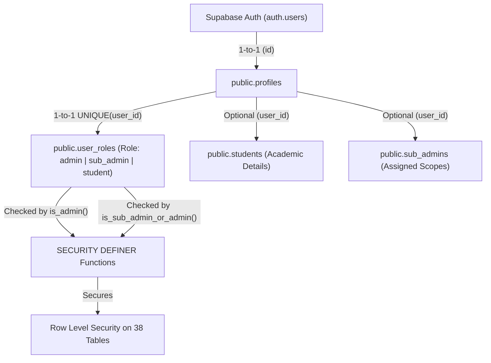
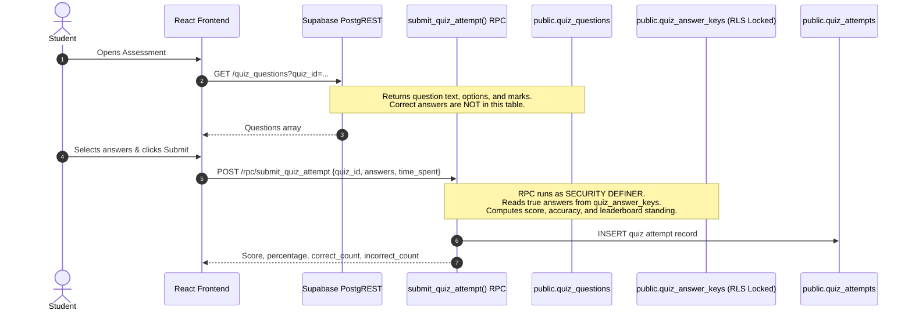

# SkillNova Database & Security Architecture
**Authoritative Backend Documentation & Database Directory Specification**
*PostgreSQL 17.11 • Supabase Auth • Supabase Storage • Row Level Security (RLS)*

---

## 1. Directory Structure

```text
supabase/
├── schema.sql                     # Authoritative single source of truth for database schema & RLS
├── README.md                      # Comprehensive database architecture and operations manual
├── migrations/                    # Versioned, production-ready schema migration files
└── backups/
    ├── backup_live_data.json      # Structured JSON live data backup (Curriculum, Settings, Roles)
    └── backup_live_data.sql       # Idempotent SQL restore script for production recovery
```

---

## 2. Platform Architecture & Identity Model

SkillNova utilizes **Supabase Auth** as its cryptographic identity provider and **PostgreSQL 17.11** with strict **Row Level Security (RLS)**.



### Identity Rules & Principles
1. **Source of Truth**: `auth.users.id` is the immutable UUID primary key across all identity relationships.
2. **Profile Sync**: The `on_auth_user_created` trigger automatically provisions `public.profiles` upon user confirmation/sign-up.
3. **Role Assignment Security**: New user registrations strictly default to the `student` role. Elevating accounts to `admin` or `sub_admin` requires authorized administrative execution or database operator action.
4. **Zero Client Escalation**: Client code cannot pass role metadata during `auth.signUp()` to claim admin privileges.

---

## 3. Database Table Directory (38 Application Tables)

The database schema is organized into 10 modular functional domains:

### 3.1 Identity & RBAC
- **`public.profiles`**: Core user metadata (full name, avatar, theme preference). 1-to-1 with `auth.users`.
- **`public.user_roles`**: Single authoritative primary role (`admin`, `sub_admin`, `student`) with `UNIQUE(user_id)`.
- **`public.students`**: Academic profile (college, branch, year of study, cohort batch year).
- **`public.sub_admins`**: Staff profile with granular permissions and assigned course IDs.
- **`public.batches`**: Student batch schedules and cohort definitions.

### 3.2 Curriculum & Academic Hierarchy
- **`public.courses`**: Course catalog with fee, duration, mentor info, and publishing state.
- **`public.course_enrollments`**: Student course registration records with enrollment timestamps.
- **`public.modules`**: Major structural units of each course (ordered by `order_index`).
- **`public.sub_modules`**: Sub-units within modules containing granular learning sessions.
- **`public.topics`**: Daily lesson schedules, class dates, and release states.

### 3.3 Learning Resources & Slide Delivery
- **`public.learning_resources`**: Course materials (notes, cheat sheets, assignments, solution guides).
- **`public.presentations`**: Classroom presentation decks and slide metadata.
- **`public.presentation_slide_allocations`**: Sub-module slide allocations with release scheduling.
- **`public.pdf_page_allocations`**: Granular PDF reading assignments by page ranges.
- **`public.resource_views`**: Telemetry tracking resource downloads and views by students.

### 3.4 Secure Assessments & Server-Side Grading
- **`public.quizzes`**: Assessment headers (duration, total marks, active/closed status, time window).
- **`public.quiz_questions`**: Assessment questions and option keys (correct answers are strictly isolated).
- **`public.quiz_answer_keys`**: Private answer vault accessible exclusively to staff and server RPC.
- **`public.quiz_attempts`**: Student submission logs, scores, accuracy, and leaderboard rankings.

### 3.5 Student Progress & Coding Lab Submissions
- **`public.student_progress`**: Unified syllabus tracking, completed sub-modules, and roadmap progress.
- **`public.practical_submissions`**: Python coding lab Monaco IDE + Pyodide WASM exercise submissions.

### 3.6 Collaboration, Discussions & Mentorship
- **`public.discussion_posts`**: Course and sub-module forum discussion threads.
- **`public.discussion_replies`**: Peer and instructor replies on discussion posts.
- **`public.mentor_requests`**: 1-on-1 mentorship and doubt clearing tickets.
- **`public.mentor_request_replies`**: Dialogue replies within mentorship tickets.

### 3.7 AI Study Tools & Generation Pipelines
- **`public.ai_generation_jobs`**: Asynchronous background jobs generating educational study tools.
- **`public.generated_summaries`**: AI-synthesized concept briefs for topics.
- **`public.flashcards`**: AI-generated spaced repetition flashcards for active recall.
- **`public.interview_questions`**: Curated interview questions, model answers, and evaluation points.

### 3.8 Saturday Special & Placement Opportunities
- **`public.saturday_special`**: Weekly industry guest lecture webinars and recording archives.
- **`public.opportunities`**: Internship and job board listings with application deadlines.

### 3.9 Communication & Student Access
- **`public.announcements`**: System-wide announcements targeted to specific courses or batches.
- **`public.notifications`**: In-app student alerts (read/unread states).
- **`public.student_access_requests`**: Course trial and module unlock requests.
- **`public.student_access_request_events`**: Audit history of student access approvals and rejections.

### 3.10 Marketing, Governance & Audit Logging
- **`public.homepage_settings`**: Landing page hero video, WhatsApp community links, and social URLs.
- **`public.homepage_courses`**: Featured course catalog displayed on the public landing page.
- **`public.audit_logs`**: Tamper-evident administrative audit log recording sensitive actions.

---

## 4. Secure Assessment Architecture

To prevent client inspection of correct answers, SkillNova isolates questions from their solutions:



---

## 5. Storage Buckets

| Bucket Name | Access Level | Description | Allowed Content |
|---|---|---|---|
| `course-materials` | Private | Protected lecture notes, solution PDFs, and code assets | Authenticated enrolled students |
| `course-roadmaps` | Public | Course syllabus visual roadmaps and curriculum flowcharts | Public Web |
| `ai-docs` | Private | Uploaded PDF textbooks and notes used for AI summarization | Staff & AI generation service |
| `user-avatars` | Public | Profile pictures of students, mentors, and administrators | Public Web |

---

## 6. Disaster Recovery & Backup Verification

Live data backups are permanently archived in `supabase/backups/`:

- **`backup_live_data.json`**: Complete structured snapshot of courses, modules, sub-modules, homepage configuration, and active quizzes.
- **`backup_live_data.sql`**: Fully idempotent SQL script that can be executed against any clean PostgreSQL database to re-seed genuine application data without data loss.

### How to Restore Live Data
```bash
# Execute idempotent SQL data restore
npx supabase db query --remote --yes -f supabase/backups/backup_live_data.sql
```

---

## 7. Migration Policy & Best Practices

1. All prospective schema changes must be developed in `supabase/migrations/<timestamp>_<feature_name>.sql`.
2. Once validated, changes must be reflected in `supabase/schema.sql` to preserve its status as the **Single Source of Truth**.
3. Never drop tables in production migrations without pre-migration data export.
4. Always wrap multi-statement DDL in transaction blocks or ensure statements are fully idempotent (`IF NOT EXISTS`, `DROP POLICY IF EXISTS`).

